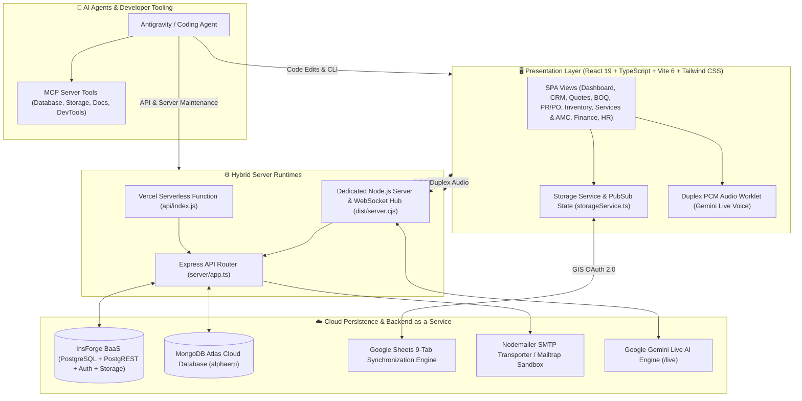
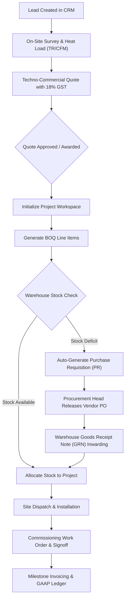
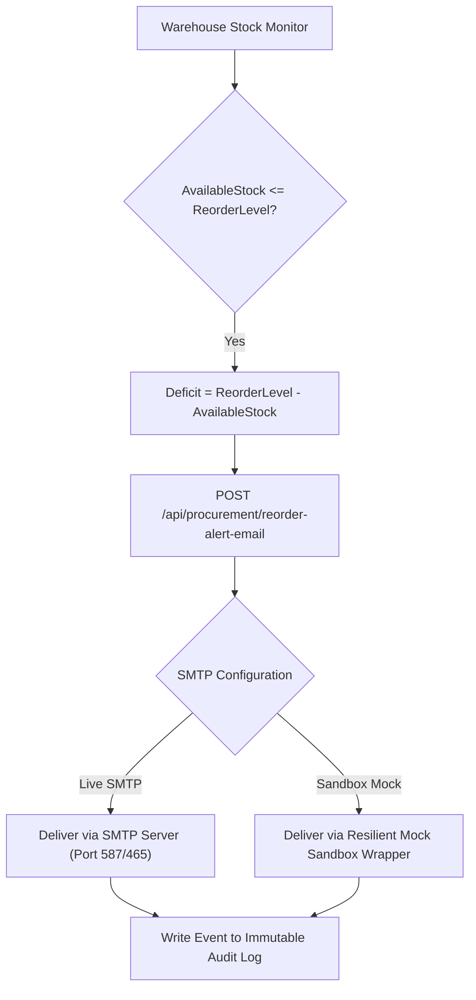

# AlphaERP — AI Agent & Developer Architecture Guidelines

## Enterprise HVAC Techno-Commercial, BOQ Engineering, Multi-Tier Procurement & Multi-Cloud Backend

**Target Repository:** `AlphaERP-V1`  
**Live Production Applet:** [https://hvacbiz.insforge.site/#dashboard](https://hvacbiz.insforge.site/#dashboard) (Custom InsForge Domain) | [https://hvacbiz.vercel.app](https://hvacbiz.vercel.app)  
**Version:** 3.6.0-Production

---

## 1. System Architecture & Component Interactions



---

## 2. Technology Stack & Hard Constraints

1. **Frontend**: React 19, TypeScript 5.8+, Vite 6, Tailwind CSS v4, Lucide React icons, Motion animations.
2. **Backend**: Express 4.21+ running on Node.js 20+ with esbuild bundling:
   - `server.ts`: Standalone Node.js server with WebSockets & dynamic port allocation (`PORT || 3001`, auto-discovers next free port on collision).
   - `dist/server.cjs`: Standalone Node.js bundle for Docker, Cloud Run, and Ubuntu Systemd/PM2.
   - `api/index.js`: Serverless bundle for Vercel Serverless Functions.
3. **Database Options**:
   - **InsForge BaaS / PostgreSQL 14+**: Relational schemas in `database/schema.sql` and `database/insforge_schema.sql`.
   - **MongoDB Atlas**: Document store with endpoints in `server/mongodb.ts` and `/api/mongodb/*`.
   - **Local MongoDB Vault**: `data/mongodb_local_vault.json` for resilient mock records & offline fallback.
   - **Browser Storage**: IndexedDB and reactive LocalStorage in `src/services/storageService.ts`.
4. **AI & Voice Engine**: Google GenAI SDK (`@google/genai`) and WebSocket duplex streaming (`/live`).
5. **Email System**: Nodemailer with dynamic fallback to Mock Sandbox wrapper when SMTP credentials are absent.

---

## 3. InsForge Backend-as-a-Service (BaaS) Architecture

This project is configured with [InsForge](https://insforge.dev) for PostgreSQL database operations, user authentication, file storage, edge functions, and real-time events.

- **Project Name:** **hvac-biz**
- **API Base URL:** `https://as2hwz72.us-east.insforge.app`

### 3.1 SDK Client Initialization

```typescript
import { createClient } from '@insforge/sdk';

export const insforge = createClient({
  baseUrl: process.env.VITE_INSFORGE_URL || 'https://as2hwz72.us-east.insforge.app',
  anonKey: process.env.VITE_INSFORGE_ANON_KEY || 'your-anon-key-here'
});
```

### 3.2 Critical InsForge Implementation Rules

- **Array Insert Rule**: All database inserts **MUST** use array format:

  ```typescript
  // CORRECT
  const { data, error } = await insforge.database
    .from('projects')
    .insert([{ project_code: 'PRJ-2026-001', name: 'One BKC Tower' }]);

  // INCORRECT - WILL FAIL
  // .insert({ project_code: 'PRJ-2026-001' })
  ```

- **Error Handling**: All SDK methods return a `{ data, error }` tuple. Always check `if (error)` before proceeding.
- **User Association**: Reference users via `auth.users(id)` and use `auth.uid()` in Row Level Security (RLS) policies.
- **Storage Operations**: When uploading files, always persist both the returned `url` and `key`.

---

## 4. End-to-End HVAC Engineering & Techno-Commercial Workflows

### 4.1 HVAC Quotation to Project BOQ Lifecycle



### 4.2 Predictive Inventory Safety-Stock Alert Process



---

## 5. REST & WebSocket API Endpoints

| Method | Endpoint | Description | Key Parameters |
| :--- | :--- | :--- | :--- |
| `GET` | `/api/health` | Service health, model status & DB config | None |
| `POST` | `/api/procurement/reorder-alert-email` | Dispatches low-stock email alerts | `recipients`, `itemsSummary`, `smtpConfig` |
| `POST` | `/api/service/amc-expiry-alert-email` | Dispatches 30-day AMC contract expiry alerts to sales team | `recipients`, `contracts`, `smtpConfig` |
| `POST` | `/api/email/test-connection` | Validates SMTP connection and sends test email | `host`, `port`, `username`, `password`, `testRecipient` |
| `GET` | `/api/mongodb/status` | MongoDB cluster connection state & stats | None |
| `POST` | `/api/mongodb/test` | Tests MongoDB Atlas ping latency | None |
| `POST` | `/api/mongodb/migrate` | Migrates local state payload into MongoDB | `payload: { projects, quotes, leads, inventory }` |
| `GET` | `/api/mongodb/export` | Full snapshot export of all collections | None |
| `POST` | `/api/mongodb/restore` | Full database restore endpoint from MongoDB snapshot | None |
| `POST` | `/api/mongodb/config` | Dynamic runtime update of MongoDB Atlas connection URI | `uri`, `databaseName` |
| `GET` | `/api/mongodb/projects` | Fetches projects array from MongoDB | None |
| `POST` | `/api/mongodb/projects` | Bulk-saves projects array to MongoDB | `projects: [...]` |
| `POST` | `/api/mongodb/project` | Upserts single project in MongoDB | `project: { id, ... }` |
| `GET` | `/api/admin/env` | Retrieves environment variables status & masked secrets | None (SuperAdmin/Admin) |
| `POST` | `/api/admin/env` | Updates and persists runtime environment secrets to `.env` | `variables: {...}`, `removedKeys: [...]` |
| `POST` | `/api/admin/env/test` | Live test connection for API keys, DBs, and SMTP | `key`, `value` |
| `GET` | `/api/admin/env/raw` | Exports raw formatted `.env` content as attachment | None (SuperAdmin/Admin) |
| `WS` | `/live` | Duplex real-time audio voice assistant | 16kHz PCM upstream / 24kHz PCM downstream |

---

## 6. Directory Layout & Module Responsibilities

```text
AlphaERP-V1/
├── api/index.ts                         # Vercel Serverless Function adapter
├── data/
│   └── mongodb_local_vault.json         # Local MongoDB vault with mock project records & offline fallback
├── server/
│   ├── app.ts                           # Express application & REST routes
│   ├── api-entry.ts                     # Bundling entrypoint for Vercel
│   ├── envManager.ts                    # Dynamic .env secrets manager & validation
│   └── mongodb.ts                       # MongoDB Atlas driver & sync operations
├── server.ts                            # Standalone Node.js server with WebSockets & dynamic port allocation
├── vercel.json                          # Vercel routing rules & security headers
├── database/
│   ├── schema.sql                       # PostgreSQL 14+ DDL Schema
│   ├── insforge_schema.sql              # InsForge BaaS PostgreSQL schema
│   └── seed_data.sql                    # Production HVAC seed data
├── src/
│   ├── App.tsx                          # Root shell, license guard & role state
│   ├── main.tsx                         # DOM mounting point
│   ├── index.css                        # Tailwind CSS global styling
│   ├── types/index.ts                   # TypeScript interfaces, enums & DRM license types
│   ├── services/
│   │   ├── storageService.ts            # Reactive storage, audit logger, DRM licensing & RBAC versioning (PERMISSIONS_SCHEMA_VERSION = '5')
│   │   ├── amcRenewalNotificationService.ts # Automated 30-day AMC expiry scanner & alert dispatcher
│   │   ├── unifiedProjectSyncService.ts # Unified multi-cloud database synchronization service
│   │   ├── googleSheets.ts              # Google Identity Services 9-tab sync
│   │   └── whatsappEmailService.ts      # SMTP alert & WhatsApp formatters
│   └── components/
│       ├── DashboardView.tsx            # Executive KPI & P&L widgets
│       ├── CRMLeadsView.tsx             # Leads & site survey scheduler
│       ├── QuotesView.tsx               # HVAC quotation builder & pricing
│       ├── ProjectsBOQView.tsx          # BOQ shortage reconciliation
│       ├── ProcurementPRPOView.tsx      # PR/PO lifecycle & approvals
│       ├── InventoryWarehouseView.tsx   # Warehouse inventory & bin locations
│       ├── PredictiveInventoryReorderPanel.tsx # Safety-stock alerts & email dispatch
│       ├── ServicesAMCView.tsx          # AMC contract builder, breakdown tickets, equipment registry & telemetry
│       ├── ServiceScheduleView.tsx      # PPM calendar, technician routing & field dispatch
│       ├── WorkOrdersView.tsx           # Field commissioning tickets & testing checklists
│       ├── FinancePaymentsView.tsx      # Milestone invoices & receipts
│       ├── FinanceView.tsx              # GAAP double-entry ledger
│       ├── HRView.tsx                   # 12-module HRMS suite
│       ├── SalesPerformanceView.tsx     # Quota tracking & leaderboard
│       ├── LicenseManagementView.tsx    # Enterprise DRM License generator & seat control (SuperAdmin only)
│       ├── PitchDeckView.tsx            # Stakeholder & Investor Pitch Deck presentation (SuperAdmin only)
│       ├── OrganizationLogoCustomizer.tsx # Enterprise branding logo customizer & dual-theme previews
│       ├── SodMatrixManager.tsx         # Segregation of Duties (SoD) governance matrix
│       ├── EnterpriseFunctionsRolesManager.tsx # Granular 36 enterprise functions catalog & custom roles
│       ├── EnvironmentVariablesAdminSection.tsx # SuperAdmin secrets & .env management panel
│       ├── EmailSettingsAdminSection.tsx# SMTP credentials & Sandbox mode
│       ├── LiveAudioAssistantModal.tsx  # Gemini Live voice assistant
│       ├── MongoSyncModal.tsx           # MongoDB Atlas cloud sync
│       └── UserManagementView.tsx       # RBAC role management & user account activation
```

---

## 7. Verification & Testing

Before submitting changes, ensure you execute:

```bash
# 1. Type-checking and static analysis (0 errors expected)
npm run lint

# 2. End-to-End Enterprise UAT Test Suite (24 Use Cases, 92 Steps - 100% Passing)
npm run test:uat

# 3. Build verification for all targets (Vite SPA + Serverless + Standalone Server)
npm run build
```

---

## 8. Sidebar Navigation & RBAC Module Visibility

The sidebar (`src/components/Sidebar.tsx`) renders `navGroups` in this fixed order:

| # | Group ID | Sidebar Label |
| :---: | :--- | :--- |
| 1 | `executive` | Executive & Strategy |
| 2 | `sales_eng` | Sales & Engineering |
| 3 | **`services_section`** | **Services & AMC Contracts** *(immediately below Sales & Engineering)* |
| 4 | `procurement_field` | Supply Chain & Procurement |
| 5 | `finance_section` | Finance & Accounting |
| 6 | `hr_section` | AlphaHR & Talent Operations |
| 7 | `master_section` | Master Data Hub |
| 8 | `system_section` | System & Administration |

### Persona Hierarchy & Role Definitions

| Role ID | Role Title | Key Scope & Guardrails |
| :--- | :--- | :--- |
| `superadmin` | Root Super Administrator | Full unrestricted control, exclusive Investor Pitch Deck, enterprise license generator & DRM timeframe controls, admin account activation/deactivation |
| `admin` | Enterprise System Administrator | Enterprise administrator with complete operational access to all business workflows, master data, user roster, and audit trails |
| `executive` | Executive / Managing Director | Strategic oversight, approvals across CRM, Quotes, BOQ, Procurement, Services, Finance, and HRMS |
| `sales_manager` | Head of Sales & Marketing | CRM leads, quotes, customer accounts, sales quotas, and revenue analytics |
| `estimator` | HVAC Estimation & Sizing Engineer | Heat load calculations, equipment sizing, BOQ generation, and quotation margin calculations |
| `service_manager` | Service Operations Manager | AMC contracts, PPM scheduling, breakdown ticket dispatch, and field engineer assignments |
| `technician` | Senior HVAC Field Engineer | Field work orders, commissioning signoffs, PPM checklist execution, and telemetry logging |
| `warehouse` | Stores & Logistics Officer | Inventory counts, bin locations, GRN inwarding, stock reservation, and dispatch notes |
| `procurement` | Head of Supply Chain & Sourcing | Purchase requisitions (PR), RFQs, purchase orders (PO), vendor master, and delivery tracking |
| `finance` | Chief Financial Officer / Controller | Milestone invoicing, AR/AP, tax compliance (GST & TDS), and GAAP double-entry ledger |
| `hr_manager` | Head of Human Resources | Recruitment, biometric attendance, payroll processing, employee records, and grievances |

### SuperAdmin-Exclusive Modules

- **Investor Pitch Deck (`pitch_deck`)**: Strictly accessible to `superadmin` only.
- **Enterprise Licensing & DRM (`license`)**: Strictly accessible to `superadmin` only.

### Services & AMC RBAC Module IDs

| Tab Label | Module ID | Default Roles |
| :--- | :--- | :--- |
| Services & AMC Contracts | `services_amc` | superadmin, admin, executive, sales_manager, estimator, technician, warehouse, service_manager |
| Service Scheduling & PPM | `services_schedule` | superadmin, admin, executive, sales_manager, estimator, technician, warehouse, service_manager |
| Work Orders & Field Dispatch | `workorders` | superadmin, admin, executive, technician, warehouse, service_manager |

A sidebar group is only rendered if **at least one** of its items passes the `allowedModuleIds` filter for the active role. If all items in a group are filtered out, the entire group header is hidden.

### RBAC Permissions Schema Versioning — Critical Agent Rule

`storageService.ts` declares a **private static** `PERMISSIONS_SCHEMA_VERSION` (`'5'` as of v3.6.0). On every app load, `getRoleModulePermissions()` compares the stored `systemSettings.permissionsSchemaVersion` against this constant:

- **Version match** → use cached permissions (normal path).
- **Version mismatch** → **force-rebuild** `roleModulePermissions` from `DEFAULT_ROLE_MODULE_PERMISSIONS` in `rbac.ts`, persist the new version stamp, and return fresh permissions.

> **⚠️ Agent Rule**: Whenever you add a new module ID to `DEFAULT_ROLE_MODULE_PERMISSIONS` in `src/utils/rbac.ts`, you **MUST** also increment `PERMISSIONS_SCHEMA_VERSION` in `src/services/storageService.ts` (e.g., `'5'` → `'6'`). Failure to do this will leave users with stale cached permissions that hide the new module in the sidebar.

<!-- INSFORGE:START -->
## InsForge backend

This project uses [InsForge](https://insforge.dev): an all-in-one, open-source Postgres-based backend (BaaS) that gives this app a database, authentication, file storage, edge functions, realtime, an AI model gateway, and payments through one platform.

- **Project:** **oss-project** (API base `https://as2hwz72.us-east.insforge.app`)
- **Skills:** these InsForge skills are installed for supported coding agents. Reach for them before implementing any InsForge feature instead of guessing the API:
  - `insforge`: app code with the `@insforge/sdk` client (database CRUD, auth, storage, edge functions, realtime, AI, email, and Stripe payments).
  - `insforge-cli`: backend and infrastructure via the `insforge` CLI (projects, SQL, migrations, RLS policies, storage buckets, functions, secrets, payment setup, schedules, deploys).
  - `insforge-debug`: diagnosing failures (SDK/HTTP errors, RLS denials, auth and OAuth issues) and running security or performance audits.
  - `insforge-integrations`: wiring external auth providers (Clerk, Auth0, WorkOS, Better Auth, etc.) for JWT-based RLS, or the OKX x402 payment facilitator.
  - `find-skills`: discovering additional skills on demand.
- **Credentials:** app code reads keys from `.env.local`; the CLI reads `.insforge/project.json`. Never hardcode or commit keys.

Key patterns:

- Database inserts take an array: `insert([{ ... }])`.
- Reference users with `auth.users(id)`; use `auth.uid()` in RLS policies.
- For storage uploads, persist both the returned `url` and `key`.
<!-- INSFORGE:END -->
