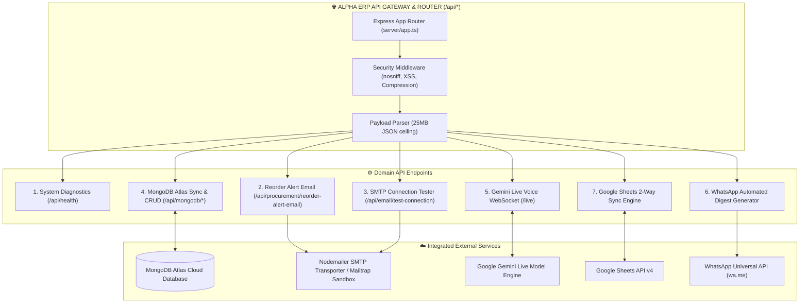

# AlphaERP: Complete Step-by-Step API Integration Guide

## Enterprise HVAC Techno-Commercial, BOQ Verification, WhatsApp Automated Digest, Email/SMTP Alerts, MongoDB Cloud Sync & Gemini Live APIs

**Document Version:** 3.5.0-Production  
**Base Production URL:** `https://hvacbiz.vercel.app`  
**WebSocket Protocol:** `ws://<host>/live` (or `wss://<host>/live` on HTTPS)

---

## 1. API Architecture & Microservices Overview

AlphaERP exposes a unified REST and WebSocket API architecture that interfaces with persistence engines, automated communication relays, and AI models.



---

## 2. Authentication & Headers

Standard API requests accept JSON payloads and custom tenancy headers:

```http
Authorization: Bearer <API_ACCESS_TOKEN>
Content-Type: application/json
X-Alpha-Tenant-ID: default-corp
X-Alpha-Client-Version: 3.5.0
```

---

## 3. Core REST Endpoints

### 3.1 System Health & Diagnostics

#### `GET /api/health`

Returns backend service health, AI model capability, and database connectivity.

**Response `200 OK`:**

```json
{
  "status": "ok",
  "model": "gemini-3.1-flash-live-preview",
  "apiKeyConfigured": true,
  "mongoConfigured": true,
  "timestamp": "2026-09-10T00:00:00.000Z"
}
```

---

### 3.2 Automated Procurement & Email Alert APIs

#### `POST /api/procurement/reorder-alert-email`

Sends an automated, itemized email alert to the procurement team whenever inventory falls below safety thresholds. Supports both dummy sandbox mode (Mailtrap/Ethereal) and live authenticated SMTP relays.

**Request Payload:**

```json
{
  "recipients": ["procurement@atmosaircon.com", "inventory@atmosaircon.com"],
  "subject": "URGENT: HVAC Critical Material Reorder Alert",
  "itemsSummary": [
    {
      "name": "Hard Drawn Copper Pipe 1/2 inch",
      "sku": "COP-PIPE-12-HD",
      "category": "Piping & Valves",
      "availableStock": 4,
      "reorderLevel": 12,
      "deficit": 8,
      "unit": "Lengths",
      "warehouseLocation": "Bay B-02"
    }
  ],
  "html": "<h3>Critical Reorder Required</h3><p>Deficit items list...</p>",
  "text": "Critical Reorder Required: 8 Lengths of Hard Drawn Copper Pipe 1/2 inch",
  "smtpConfig": {
    "host": "smtp.mailtrap.io",
    "port": 587,
    "username": "sandbox_user",
    "password": "sandbox_pass",
    "senderEmail": "procurement@alphaerp.com",
    "senderName": "AlphaERP Procurement System",
    "mode": "smtp"
  }
}
```

**Response `200 OK` (Live SMTP):**

```json
{
  "success": true,
  "mode": "smtp",
  "isRealSmtp": true,
  "messageId": "<c28d49a-78b1-42e1-a08b-1234567890ab@alphaerp.com>",
  "recipients": ["procurement@atmosaircon.com", "inventory@atmosaircon.com"],
  "timestamp": "2026-09-10T00:00:00.000Z",
  "note": "Email successfully dispatched via configured SMTP server (smtp.mailtrap.io)"
}
```

**Response `200 OK` (Sandbox / Mock Mode):**

```json
{
  "success": true,
  "mode": "mock_wrapper",
  "isRealSmtp": false,
  "messageId": "mock-smtp-1725926400000-a1b2c3@alphaerp.local",
  "recipients": ["procurement@atmosaircon.com"],
  "timestamp": "2026-09-10T00:00:00.000Z",
  "note": "Email recorded and dispatched via AlphaERP resilient Mock Sandbox."
}
```

---

#### `POST /api/email/test-connection`

Verifies SMTP host credentials and triggers a test email dispatch.

**Request Payload:**

```json
{
  "host": "smtp.mailtrap.io",
  "port": 587,
  "secure": false,
  "username": "sandbox_user",
  "password": "sandbox_pass",
  "senderName": "AlphaERP Test Engine",
  "senderEmail": "notifications@alphaerp.com",
  "testRecipient": "admin@atmosaircon.com",
  "mode": "smtp",
  "provider": "Mailtrap Sandbox"
}
```

**Response `200 OK`:**

```json
{
  "success": true,
  "mode": "smtp",
  "messageId": "<test-12345@alphaerp.com>",
  "recipients": ["admin@atmosaircon.com"],
  "timestamp": "2026-09-10T00:00:00.000Z",
  "note": "Authenticated and sent test email to admin@atmosaircon.com via smtp.mailtrap.io:587"
}
```

---

### 3.3 MongoDB Atlas Cloud Synchronization APIs

#### `GET /api/mongodb/status`

Checks MongoDB Atlas cluster connectivity, ping latency, and collection statistics.

**Response `200 OK`:**

```json
{
  "configured": true,
  "connected": true,
  "databaseName": "alphaerp",
  "pingMs": 42,
  "collectionsCount": 8,
  "collections": {
    "projects": 14,
    "quotes": 26,
    "leads": 42,
    "inventory": 180,
    "purchase_orders": 35
  }
}
```

#### `POST /api/mongodb/test`

Performs an active database ping to measure round-trip latency.

#### `POST /api/mongodb/migrate`

Transfers the complete local state payload into linked MongoDB collections.

**Request Payload:**

```json
{
  "payload": {
    "projects": [ /* array of project objects */ ],
    "quotes": [ /* array of quote objects */ ],
    "leads": [ /* array of lead objects */ ],
    "inventory": [ /* array of inventory objects */ ]
  }
}
```

**Response `200 OK`:**

```json
{
  "success": true,
  "migratedAt": "2026-09-10T00:00:00.000Z",
  "counts": {
    "projects": 14,
    "quotes": 26,
    "leads": 42,
    "inventory": 180
  }
}
```

#### `GET /api/mongodb/export`

Exports a full snapshot backup of all collections from MongoDB Atlas.

#### `GET /api/mongodb/projects` & `POST /api/mongodb/projects`

Reads or bulk-saves HVAC project execution records in MongoDB Atlas.

#### `POST /api/mongodb/project`

Upserts a single project record by its unique `id` in MongoDB Atlas.

---

### 3.4 Gemini Live Audio Assistant API (Duplex WebSocket)

AlphaERP includes an ultra-low latency real-time voice assistant powered by Gemini Live:

- **Endpoint**: `ws://<host>/live` (or `wss://<host>/live` on HTTPS)
- **Audio Specification**:
  - Upstream: Raw Linear PCM 16kHz, 16-bit Mono (Base64 encoded chunks).
  - Downstream: Raw Linear PCM 24kHz, 16-bit Mono (Base64 encoded chunks).
- **Message Framing**:

  ```json
  // Client upstream audio frame
  { "audio": "<base64 PCM 16kHz chunk>" }

  // Client upstream text prompt
  { "text": "Calculate duct aspect ratio for 2400 CFM at 1200 FPM velocity" }

  // Server downstream audio response
  { "audio": "<base64 PCM 24kHz chunk>" }

  // Server downstream transcription
  { "text": "For 2400 CFM at 1200 FPM, required area is 2.0 sq ft...", "sender": "model" }
  ```

---

### 3.5 Automated WhatsApp Daily KPI Trigger

Generates automated previous-day business metrics and dispatches via `https://wa.me`:

```text
📊 *ALPHA HVAC ENTERPRISE — DAILY BUSINESS KPI DIGEST*
📅 *Snapshot Date:* 10 Sep 2026

1️⃣ *NEW LEADS GENERATED (Sales Pipeline)*
• Total New Leads: *3 Leads* (Pipeline Value: ₹46.50 Lakhs)

2️⃣ *BILL COLLECTIONS RECEIVED*
• Total Collection: *₹4,85,000* (Efficiency: 78.5%)

3️⃣ *PENDING RECEIVABLES AGING*
• 0–30 Days: ₹8,20,000 | 31–60 Days: ₹5,10,000 | >90 Days: ₹2,00,000

4️⃣ *DELAYED PROJECTS & ROOT CAUSES*
⚠️ *PRJ-2026-001 (One BKC Tower)*: 14 Days Delayed (Client civil site clearance)
```

---

### 3.6 Google Sheets Multi-Tab Synchronization Engine

Synchronizes full bi-directional collections across Google Spreadsheets:

- `Leads_Master` & `Quotes_Register`
- `Projects_BOQ` & `Work_Orders`
- `Inventory_Warehouse` (SKUs, Locations, Safety Stocks)
- `Purchase_Requisitions` & `Purchase_Orders`
- `Goods_Receipt_Notes` & Vendor Inwarding
- `Milestone_Invoices` & Payment Receipts
- `HR_Employee_Master`, Payroll Cycles & Biometric Logs
- `AMC_Service_Contracts` (Comprehensive & Non-Comprehensive)
- `PPM_Maintenance_Visits` & 4-Point Telemetry Logs
- `Breakdown_Emergency_Tickets` & Spare Parts Consumption
- `Audit_Logs` (Immutable Ledger)

---

### 3.7 AMC 30-Day Renewal Notification & Telemetry Logging Service

#### Automated 30-Day AMC Expiry Scan

The automated AMC Renewal Engine (`src/services/amcRenewalNotificationService.ts`) inspects active contracts daily. When a contract enters the 30-day expiry threshold:

1. Calculates remaining days until expiry.
2. Compiles covered equipment inventory and historical PPM visit compliance.
3. Formats an itemized renewal estimate with standard revision index.
4. Triggers `POST /api/procurement/reorder-alert-email` or dispatches via configured SMTP transporter to both client contact and the assigned `Service Operations Manager`.

---

## 4. Security, Rate Limiting & Enterprise Validation

- **Rate Limits**: 120 req/min for general REST routes; 20 req/min for email alerts and AI endpoints.
- **WebSocket Protection**: Maximum 5 concurrent WebSocket connections per IP address with automated heartbeat ping/pong cleanup.
- **Payload Size**: Maximum 25MB JSON payload limit for database migrations and backup ingestion.
- **UAT Verification**: 100% Passing automated test suite with 17 cases and 65 verification steps (`npm run test:uat`).
