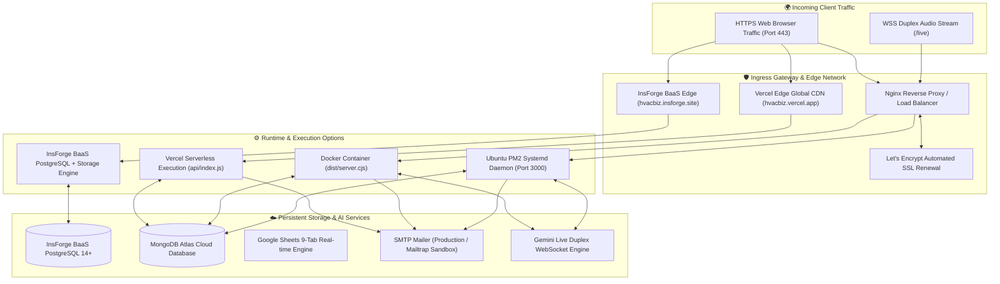

# AlphaERP: Complete Enterprise Deployment Manual

## Production Deployment for InsForge BaaS, Vercel Serverless, Google Cloud Run, Docker Containers, Ubuntu Linux, Systemd, PM2 & Nginx

**Document Version:** 3.6.0-Production  
**Primary Custom Domain:** [https://hvacbiz.insforge.site](https://hvacbiz.insforge.site)  
**Vercel Production Mirror:** [https://hvacbiz.vercel.app](https://hvacbiz.vercel.app)  
**GitHub Repository:** [https://github.com/gautam303in/AlphaERP-HVAC](https://github.com/gautam303in/AlphaERP-HVAC)  
**Ingress Host & Port:** `0.0.0.0:3001` (Standalone Server default with auto-increment on collision) | `0.0.0.0:3000` (Docker Container) | Vercel Serverless Edge | InsForge Edge

---

## 1. System Requirements & Architecture Topology

AlphaERP is engineered as an enterprise-grade, full-stack HVAC operations platform:

- **Frontend / Client**: React 19 + TypeScript + Vite 6 + Tailwind CSS v4 + Lucide Icons + Motion
- **Backend / API**: Node.js 20+ / Express with TypeScript bundling via esbuild
- **Persistence Options**: InsForge BaaS (PostgreSQL 14+), MongoDB Atlas (Cloud NoSQL), Local MongoDB Vault (`data/mongodb_local_vault.json`), or browser IndexedDB cache
- **Ingress Port**: Defaults to **Port 3001** (Host: `0.0.0.0`) in development and standalone mode with automatic collision fallback to the next available free port via `net.createServer()`, or **Port 3000** for Docker/Cloud Run container compatibility.



---

## 2. Environment Variables Specification

Declare all required variables in your runtime environment (or `.env` file):

```env
# ==============================================================================
# APPLICATION RUNTIME CONFIGURATION
# ==============================================================================
NODE_ENV=production
PORT=3000
HOST=0.0.0.0

# ==============================================================================
# INSFORGE BAAS POSTGRESQL & EDGE CONFIGURATION
# ==============================================================================
VITE_INSFORGE_URL=https://as2hwz72.us-east.insforge.app
VITE_INSFORGE_ANON_KEY=your_insforge_anon_key

# ==============================================================================
# CLOUD DATABASE PERSISTENCE (MONGODB ATLAS)
# ==============================================================================
MONGODB_URI=mongodb+srv://shivenk_db_user:<password>@cluster0.5gbrhfg.mongodb.net/alphaerp?retryWrites=true&w=majority

# ==============================================================================
# AI & VOICE INTELLIGENCE (GEMINI LIVE & THERMODYNAMIC REASONING)
# ==============================================================================
GEMINI_API_KEY=AIzaSy...YourGeminiApiKeyHere

# ==============================================================================
# AUTOMATED PROCUREMENT EMAIL & SMTP ALERTS (SANDBOX OR LIVE SMTP)
# ==============================================================================
SMTP_HOST=smtp.mailtrap.io
SMTP_PORT=587
SMTP_USER=your_smtp_username
SMTP_PASS=your_smtp_password
SMTP_FROM="AlphaERP Procurement" <procurement@alphaerp.com>
PROCUREMENT_ALERT_EMAIL=procurement@yourcompany.com

# ==============================================================================
# VERCEL PRODUCTION DEPLOYMENT CREDENTIALS (OPTIONAL)
# ==============================================================================
VERCEL_TOKEN=your_vercel_access_token
VERCEL_ORG_ID=your_org_id
VERCEL_PROJECT_ID=your_project_id
```

---

## 3. Deployment Option 1: Vercel Serverless & Edge Network (Zero Ops)

AlphaERP is pre-configured with `vercel.json` and a serverless entrypoint in `api/index.js`.

### 3.1 Automated Production Build

Running `npm run build` compiles:

1. `dist/`: High-performance static React assets served via Vercel Edge CDN.
2. `api/index.js`: Self-contained serverless bundle wrapping the Express API.
3. `dist/server.cjs`: Standalone Node.js server bundle for container runtimes.

### 3.2 Deploy via Vercel CLI

```bash
# 1. Standard production deploy
npx vercel deploy --prod --yes

# 2. Or deploy using automated token
npx vercel deploy --prod --token "$VERCEL_TOKEN" --yes
```

### 3.3 Live Production Verification

- Production Domain: `https://hvacbiz.vercel.app`
- Health Endpoint: `https://hvacbiz.vercel.app/api/health`

---

## 4. Deployment Option 2: InsForge Edge & Custom Domain

Deploy directly to InsForge hosting:

```bash
# 1. Build application bundles
npm run build

# 2. Deploy bundle via InsForge CLI
npx @insforge/cli deployments deploy .
```

- Production Domain: `https://hvacbiz.insforge.site`
- Backend BaaS Project: `hvac-biz` (`https://as2hwz72.us-east.insforge.app`)

---

## 5. Deployment Option 3: Google Cloud Run & Docker Containers

### 5.1 Production Multi-Stage Dockerfile

```dockerfile
# Stage 1: Build & Bundle
FROM node:20-alpine AS builder
WORKDIR /app

COPY package.json package-lock.json* ./
RUN npm ci

COPY . .
RUN npm run build

# Stage 2: Minimal Production Image
FROM node:20-alpine AS runner
WORKDIR /app

ENV NODE_ENV=production
ENV PORT=3000

COPY --from=builder /app/package.json ./package.json
COPY --from=builder /app/node_modules ./node_modules
COPY --from=builder /app/dist ./dist
COPY --from=builder /app/public ./public
COPY --from=builder /app/data ./data
COPY --from=builder /app/dist/server.cjs ./dist/server.cjs

EXPOSE 3000

HEALTHCHECK --interval=30s --timeout=5s --start-period=5s --retries=3 \
  CMD wget --no-verbose --tries=1 --spider http://localhost:3000/api/health || exit 1

CMD ["node", "dist/server.cjs"]
```

### 5.2 Build and Deploy to Google Cloud Run

```bash
# 1. Submit build to Google Artifact Registry
gcloud builds submit --tag gcr.io/YOUR_GCP_PROJECT_ID/alpha-erp:latest

# 2. Deploy to Cloud Run
gcloud run deploy alpha-erp \
  --image gcr.io/YOUR_GCP_PROJECT_ID/alpha-erp:latest \
  --platform managed \
  --region asia-east1 \
  --allow-unauthenticated \
  --port 3000 \
  --memory 1Gi \
  --cpu 1 \
  --min-instances 1 \
  --max-instances 10 \
  --set-env-vars NODE_ENV=production
```

---

## 6. Deployment Option 4: Ubuntu 24.04 / 22.04 LTS (Bare-Metal / VM)

### 6.1 System Setup & Node.js 20 LTS

```bash
sudo apt-get update -y && sudo apt-get upgrade -y
sudo apt-get install -y curl wget git build-essential nginx certbot python3-certbot-nginx

# Install Node.js 20 LTS
curl -fsSL https://deb.nodesource.com/setup_20.x | sudo -E bash -
sudo apt-get install -y nodejs
```

### 6.2 Build & Run with PM2

```bash
cd /opt/alpha-erp
npm ci
npm run build

# Install PM2 and launch
sudo npm install -g pm2
pm2 start dist/server.cjs --name "alpha-erp" --env production
pm2 startup systemd
pm2 save
```

### 6.3 Nginx Reverse Proxy & SSL Configuration

Create `/etc/nginx/sites-available/alpha-erp`:

```nginx
server {
    listen 80;
    server_name erp.yourdomain.com;

    client_max_body_size 50M;
    gzip on;
    gzip_types text/plain text/css application/json application/javascript text/xml;

    location / {
        proxy_pass http://127.0.0.1:3000;
        proxy_http_version 1.1;
        proxy_set_header Upgrade $http_upgrade;
        proxy_set_header Connection 'upgrade';
        proxy_set_header Host $host;
        proxy_set_header X-Real-IP $remote_addr;
        proxy_set_header X-Forwarded-For $proxy_add_x_forwarded_for;
        proxy_set_header X-Forwarded-Proto $scheme;
    }
}
```

Enable and activate Let's Encrypt SSL:

```bash
sudo ln -sf /etc/nginx/sites-available/alpha-erp /etc/nginx/sites-enabled/
sudo nginx -t && sudo systemctl reload nginx
sudo certbot --nginx -d erp.yourdomain.com --non-interactive --agree-tos -m admin@yourdomain.com
```

---

## 7. Health Check & Deployment Verification

```bash
# 1. Health & Environment Status Check
curl -s https://hvacbiz.vercel.app/api/health | jq .

# 2. Test Procurement Alert Email API
curl -X POST https://hvacbiz.vercel.app/api/procurement/reorder-alert-email \
  -H "Content-Type: application/json" \
  -d '{
    "subject": "Deployment Smoke Test",
    "recipients": ["admin@yourcompany.com"],
    "smtpConfig": { "mode": "mock" }
  }'

# 3. Test 30-Day AMC Expiry Alert Email API
curl -X POST https://hvacbiz.vercel.app/api/service/amc-expiry-alert-email \
  -H "Content-Type: application/json" \
  -d '{
    "subject": "AMC Smoke Test",
    "recipients": ["sales@yourcompany.com"],
    "smtpConfig": { "mode": "mock" }
  }'

# 4. MongoDB Cluster Connection Test
curl -s https://hvacbiz.vercel.app/api/mongodb/status | jq .

# 5. Automated Enterprise UAT Test Suite (24 Use Cases, 92 Verification Steps)
npm run test:uat
```

---

## 8. Zero-Downtime Updates & Rollbacks

```bash
cd /opt/alpha-erp
git pull origin main
npm ci
npm run build
pm2 reload alpha-erp --update-env
```

> **Permissions Cache Reset on Upgrade:** If the release bumps `PERMISSIONS_SCHEMA_VERSION` in `src/services/storageService.ts` (current: `'5'`), each user's browser will automatically detect the version mismatch on the next page load and rebuild its cached `roleModulePermissions` from the latest defaults in `src/utils/rbac.ts`. No additional migration steps, database changes, or manual browser cache clearing are required.
