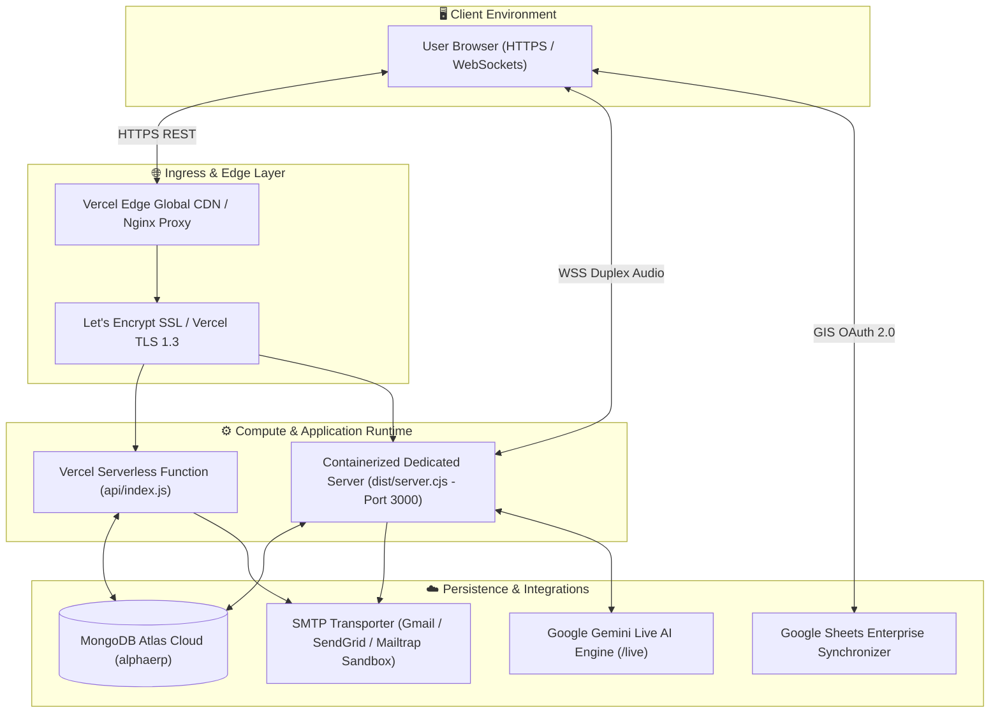
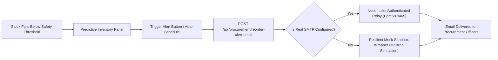

# AlphaERP: Complete Step-by-Step Implementation & Deployment Guide
### Enterprise HVAC Techno-Commercial, BOQ Engineering, Multi-Tier Procurement, Email/SMTP Alerts, GAAP Accounting & Multi-Cloud Suite

**Document Version:** 3.5.0-Production  
**Applet URL:** [https://hvacbiz.vercel.app](https://hvacbiz.vercel.app)  
**Target Environment:** Vercel Serverless / Ubuntu 24.04-22.04 LTS / Docker & Google Cloud Run

---

## 1. System Architecture & Topology



---

## 2. Supported Deployment Platforms

AlphaERP supports three standard deployment pathways:

1. **Vercel Serverless (Recommended for Instant Scalability & Zero Ops)**
   - Pre-configured with `vercel.json` and `api/index.js`.
   - Global Edge CDN for React 19 static assets and on-demand serverless functions for REST routes.
2. **Ubuntu Linux 24.04 / 22.04 LTS (Bare-Metal or Cloud VM)**
   - Full-stack Node.js 20 deployment managed via PM2 or Systemd behind an Nginx reverse proxy with automated Let's Encrypt SSL.
3. **Docker & Google Cloud Run (Containerized Microservices)**
   - Multi-stage Alpine container image listening on port 3000 with support for duplex WebSockets (`/live`).

---

## 3. Ubuntu Linux Step-by-Step Implementation

### Step 3.1: Package Update & Prerequisites Installation
```bash
sudo apt-get update -y && sudo apt-get upgrade -y
sudo apt-get install -y curl wget git build-essential nginx certbot python3-certbot-nginx ufw
```

### Step 3.2: Install Node.js 20 LTS
```bash
curl -fsSL https://deb.nodesource.com/setup_20.x | sudo -E bash -
sudo apt-get install -y nodejs
node -v   # Expected: v20.x.x
npm -v    # Expected: v10.x.x
```

### Step 3.3: Clone Repository & Install Dependencies
```bash
cd /opt
sudo git clone https://github.com/YOUR_REPO/alpha-erp.git
sudo chown -R $USER:$USER /opt/alpha-erp
cd /opt/alpha-erp
npm install
```

### Step 3.4: Configure Environment Variables
Create `/opt/alpha-erp/.env`:
```env
# Runtime Configuration
PORT=3000
NODE_ENV=production
HOST=0.0.0.0

# MongoDB Atlas Database
MONGODB_URI=mongodb+srv://shivenk_db_user:<password>@cluster0.5gbrhfg.mongodb.net/alphaerp?retryWrites=true&w=majority

# Gemini AI API Key
GEMINI_API_KEY=AIzaSy...YourGeminiApiKeyHere

# Automated Procurement Email Alerts (Sandbox or Production SMTP)
SMTP_HOST=smtp.mailtrap.io
SMTP_PORT=587
SMTP_USER=your_smtp_username
SMTP_PASS=your_smtp_password
SMTP_FROM="AlphaERP Procurement" <procurement@alphaerp.com>
PROCUREMENT_ALERT_EMAIL=procurement@yourcompany.com
```

### Step 3.5: Build the Application
```bash
npm run build
```
This build script executes:
1. `vite build`: Compiles optimized React 19 SPA into `dist/`.
2. `esbuild server.ts`: Compiles dedicated Node server into `dist/server.cjs`.
3. `esbuild server/api-entry.ts`: Compiles serverless function into `api/index.js`.

### Step 3.6: Process Management with PM2
```bash
sudo npm install -g pm2
pm2 start dist/server.cjs --name "alpha-erp" --env production
pm2 startup systemd
pm2 save
```

### Step 3.7: Configure Nginx Reverse Proxy
Create `/etc/nginx/sites-available/alpha-erp`:
```nginx
server {
    listen 80;
    server_name erp.yourdomain.com;

    client_max_body_size 50M;
    gzip on;
    gzip_types text/plain text/css text/javascript application/json application/javascript;

    location / {
        proxy_pass http://127.0.0.1:3000;
        proxy_http_version 1.1;
        proxy_set_header Upgrade $http_upgrade;
        proxy_set_header Connection 'upgrade';
        proxy_set_header Host $host;
        proxy_set_header X-Real-IP $remote_addr;
        proxy_set_header X-Forwarded-For $proxy_add_x_forwarded_for;
        proxy_set_header X-Forwarded-Proto $scheme;
    }
}
```

Enable site configuration and issue SSL certificate:
```bash
sudo ln -sf /etc/nginx/sites-available/alpha-erp /etc/nginx/sites-enabled/
sudo nginx -t
sudo systemctl reload nginx
sudo certbot --nginx -d erp.yourdomain.com --non-interactive --agree-tos -m admin@yourdomain.com
```

---

## 4. Docker & Google Cloud Run Implementation

### Step 4.1: Multi-Stage Production Dockerfile

```dockerfile
# Stage 1: Build Frontend & Backend Bundles
FROM node:20-alpine AS builder
WORKDIR /app

COPY package.json package-lock.json* bun.lock* ./
RUN npm ci

COPY . .
RUN npm run build

# Stage 2: Lightweight Production Image
FROM node:20-alpine AS runner
WORKDIR /app

ENV NODE_ENV=production
ENV PORT=3000

COPY --from=builder /app/package.json ./package.json
COPY --from=builder /app/node_modules ./node_modules
COPY --from=builder /app/dist ./dist
COPY --from=builder /app/public ./public
COPY --from=builder /app/dist/server.cjs ./dist/server.cjs

EXPOSE 3000

HEALTHCHECK --interval=30s --timeout=5s --start-period=5s --retries=3 \
  CMD wget --no-verbose --tries=1 --spider http://localhost:3000/api/health || exit 1

CMD ["node", "dist/server.cjs"]
```

### Step 4.2: Build and Deploy to Google Cloud Run
```bash
# 1. Build and push container to Google Artifact Registry
gcloud builds submit --tag gcr.io/YOUR_GCP_PROJECT_ID/alpha-erp:latest

# 2. Deploy to Cloud Run with Port 3000
gcloud run deploy alpha-erp \
  --image gcr.io/YOUR_GCP_PROJECT_ID/alpha-erp:latest \
  --platform managed \
  --region asia-east1 \
  --allow-unauthenticated \
  --port 3000 \
  --memory 1Gi \
  --cpu 1 \
  --min-instances 1 \
  --max-instances 10 \
  --set-env-vars NODE_ENV=production
```

---

## 5. Automated Procurement Email System Setup

AlphaERP includes an automated low-stock alerting system:



### Testing the Email Connection
1. In the application, navigate to **Admin Settings > Email & Alerts Configuration**.
2. Select your provider (Gmail Workspace, SendGrid, Amazon SES, or Mailtrap Sandbox).
3. Click **"Test Connection"** to verify hostname, port, and authentication credentials.
4. Alternatively, test via curl:
   ```bash
   curl -X POST https://hvacbiz.vercel.app/api/email/test-connection \
     -H "Content-Type: application/json" \
     -d '{
       "host": "smtp.mailtrap.io",
       "port": 587,
       "username": "your_user",
       "password": "your_password",
       "testRecipient": "admin@yourcompany.com"
     }'
   ```

---

## 6. Verification & Health Monitoring

### Health Check Endpoint
```bash
curl -i https://hvacbiz.vercel.app/api/health
```

Expected Response:
```json
{
  "status": "ok",
  "model": "gemini-3.1-flash-live-preview",
  "apiKeyConfigured": true,
  "mongoConfigured": true,
  "timestamp": "2026-09-10T00:00:00.000Z"
}
```

### MongoDB Database Health Ping
```bash
curl -i https://hvacbiz.vercel.app/api/mongodb/status
```

---

## 7. Zero-Downtime Update Routine

```bash
cd /opt/alpha-erp
git pull origin main
npm ci
npm run build
pm2 reload alpha-erp --update-env
```
