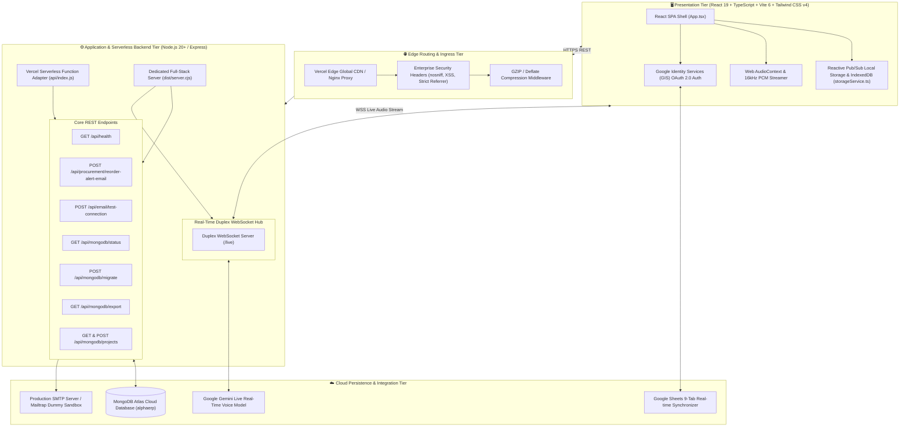
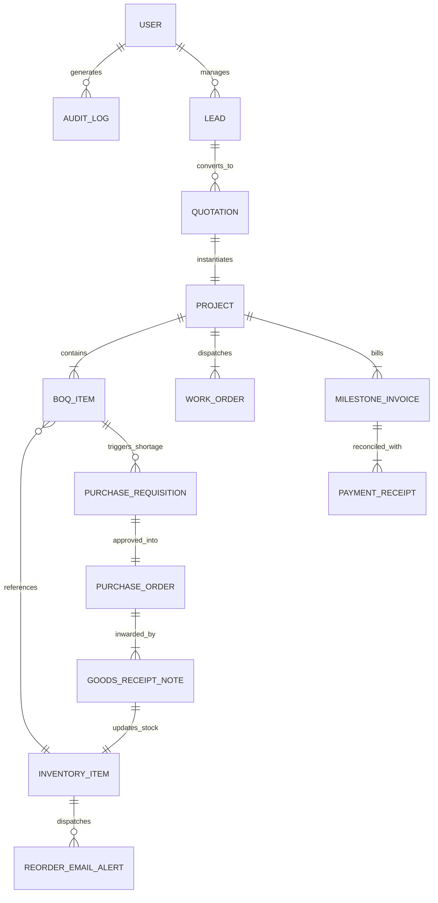
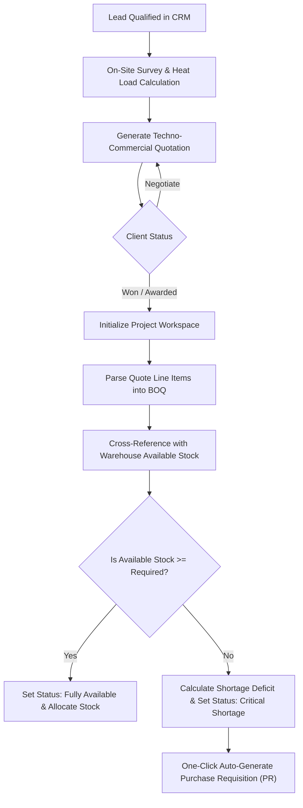
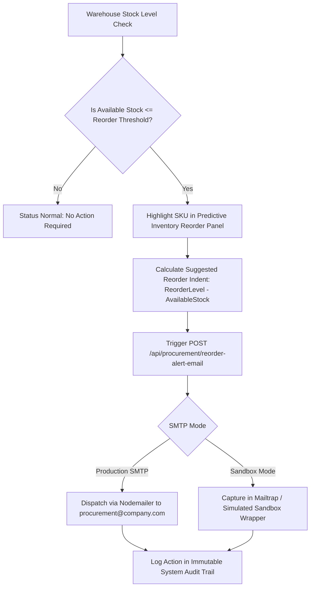
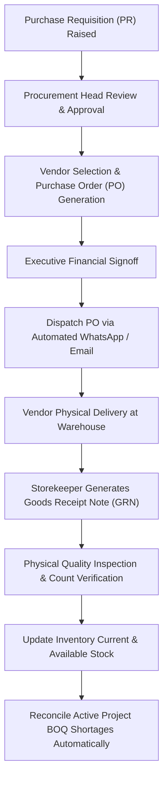
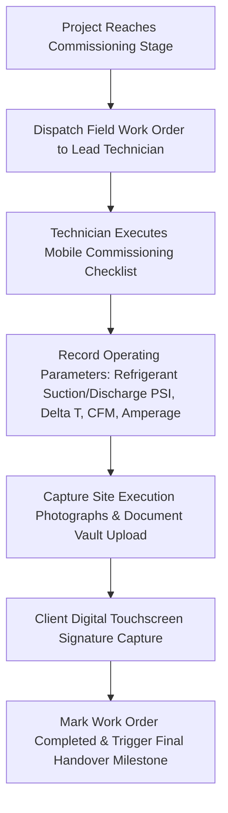
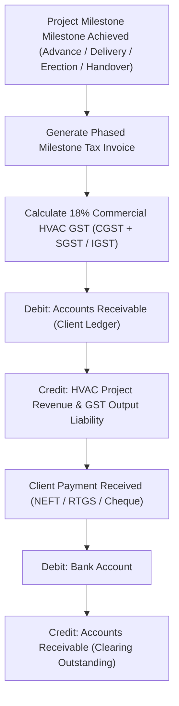

# Comprehensive Architecture & Technical Project Document (AlphaERP)
### Enterprise HVAC Techno-Commercial, BOQ Engineering, Multi-Tier Procurement, Predictive Stock Indents, GAAP Accounting & Multi-Cloud Platform

**Project Name:** AlphaERP / HVAC-Sync Pro (Commercial HVAC & MEP Enterprise Lifecycle Platform)  
**Version:** 3.5.0-Production  
**Document Author:** Google AI Studio Systems Engineering & Enterprise Solutions Architecture  
**Date:** September 2026  
**Live Production URL:** [https://hvacbiz.vercel.app](https://hvacbiz.vercel.app)  
**Target Repository:** `AlphaERP-V1`

---

## 1. Executive Summary & System Overview

**AlphaERP** is a full-stack, enterprise-grade ERP, CRM, and Supply Chain automation platform tailored specifically for Heating, Ventilation, Air Conditioning (HVAC), and MEP (Mechanical, Electrical, Plumbing) engineering contractors. The platform digitizes and unifies the operational lifecycle: from initial lead qualification and on-site engineering surveys to automated quotation generation, thermodynamic sizing, project scheduling, Bill of Quantities (BOQ) reconciliation, Purchase Requisition (PR) & Purchase Order (PO) procurement pipelines, predictive inventory alerts with automated email dispatch, warehouse stock inwarding (GRN), field work orders, multi-stage milestone billing, cloud MongoDB synchronization, and real-time Gemini Live voice interaction.

---

## 2. System Architecture & Topology

### 2.1 Multi-Tier Architecture Diagram



---

## 3. Core Entity Schemas & Data Model

### 3.1 Entity Relationship Diagram (ERD)



### 3.2 TypeScript Data Interfaces

```typescript
// 1. User & Identity
export interface User {
  id: string;
  name: string;
  email: string;
  role: 'executive' | 'procurement' | 'estimator' | 'sales_manager' | 'warehouse_manager' | 'finance' | 'technician';
  department: string;
  status: 'Active' | 'Inactive';
  phone?: string;
  createdAt: string;
  lastLoginAt?: string;
}

// 2. CRM Lead & Site Survey
export interface Lead {
  id: string;
  leadNumber: string;
  clientName: string;
  companyName: string;
  contactEmail: string;
  contactPhone: string;
  city: string;
  projectType: string;
  estimatedTonnage: number;
  estimatedBudget: number;
  stage: 'New Lead' | 'Site Survey Scheduled' | 'Site Survey Completed' | 'Quote Sent' | 'Negotiation' | 'Won / Awarded' | 'Lost';
  assignedSalesEngineer: string;
  notes: string;
  createdAt: string;
}

// 3. Techno-Commercial Quotation
export interface Quotation {
  id: string;
  quoteNumber: string;
  leadId: string;
  clientName: string;
  projectName: string;
  systemType: 'VRV/VRF' | 'Chilled Water Plant' | 'Packaged DX' | 'Ventilation & Exhaust';
  tonnage: number;
  subtotal: number;
  discountPercent: number;
  discountAmount: number;
  taxableAmount: number;
  gstAmount: number; // 18% Statutory GST
  grandTotal: number;
  rawMaterialCost: number;
  estimatedGrossMargin: number;
  status: 'Draft' | 'Sent to Client' | 'Negotiation' | 'Approved / Awarded' | 'Rejected';
  items: QuoteLineItem[];
  validUntil: string;
  createdAt: string;
}

// 4. Project & BOQ Line Item
export interface Project {
  id: string;
  projectCode: string;
  leadId: string;
  quoteId: string;
  name: string;
  clientName: string;
  systemType: string;
  tonnage: number;
  contractValue: number;
  startDate: string;
  targetHandoverDate: string;
  status: 'Engineering Planning' | 'Material Procurement' | 'Piping & Ducting' | 'Equipment Installation' | 'Testing & Commissioning' | 'Completed & Handed Over';
  progressPercent: number;
  boqItems: BOQItem[];
}

export interface BOQItem {
  id: string;
  category: 'Heavy Machinery' | 'Ducting & Air Distribution' | 'Piping & Valves' | 'Insulation' | 'Refrigerant & Consumables' | 'Electrical & Controls';
  itemSku: string;
  description: string;
  quantityRequired: number;
  quantityAllocated: number;
  quantityShortage: number;
  unit: string;
  status: 'Fully Available' | 'Partially Available' | 'Critical Shortage' | 'PR Generated';
}

// 5. Inventory & Safety Stock
export interface InventoryItem {
  id: string;
  sku: string;
  name: string;
  category: string;
  warehouseLocation: string;
  currentStock: number;
  allocatedStock: number;
  availableStock: number;
  reorderThreshold: number;
  unit: string;
  averageUnitCost: number;
  leadTimeDays?: number;
}

// 6. Procurement: PR, PO & GRN
export interface PurchaseRequisition {
  id: string;
  prNumber: string;
  projectId: string;
  requestedBy: string;
  status: 'Draft' | 'Pending Approval' | 'Approved' | 'PO Issued' | 'Rejected';
  items: {
    sku: string;
    name: string;
    quantity: number;
    estimatedCost: number;
    unit: string;
  }[];
  createdAt: string;
}

export interface PurchaseOrder {
  id: string;
  poNumber: string;
  prId: string;
  vendorName: string;
  vendorEmail: string;
  totalAmount: number;
  status: 'Issued' | 'Partially Received' | 'Completed' | 'Cancelled';
  deliveryDueDate: string;
  createdAt: string;
}

export interface GoodsReceiptNote {
  id: string;
  grnNumber: string;
  poNumber: string;
  vendorInvoiceNumber: string;
  inwardDate: string;
  inspectedBy: string;
  itemsReceived: {
    sku: string;
    quantityReceived: number;
    acceptedQuantity: number;
    rejectedQuantity: number;
  }[];
}
```

---

## 4. Key Operational Workflows & Process Logic

### Flow 1: Lead to Project Conversion & BOQ Reconciliation



### Flow 2: Predictive Safety Stock & Automated Email Procurement



### Flow 3: Procurement PR ➔ PO ➔ Vendor Dispatch ➔ GRN Stock Inwarding



### Flow 4: Field Work Order, Commissioning & Client Signoff



### Flow 5: Milestone Invoicing, GST Ledger & GAAP Double-Entry Accounting



---

## 5. Role-Based Access Control (RBAC) Matrix

| Module / Operation | Executive / MD | Sales Manager | HVAC Estimator | Procurement | Warehouse | Finance | Lead Engineer |
|---|:---:|:---:|:---:|:---:|:---:|:---:|:---:|
| **Executive Management Dashboard** | Full | View | View | View | View | View | View |
| **CRM Leads & Site Survey** | Full | Full | View | View | No | View | No |
| **Quotation & Margin Engine** | Full | Full | Full | View | No | View | No |
| **Project Milestones & Gantt** | Full | View | View | View | View | View | Full |
| **BOQ Stock Shortage Reconciliation**| Full | View | Full | View | View | View | View |
| **Raise Purchase Requisition (PR)**| Full | No | Full | Full | Full | No | No |
| **Issue Purchase Order (PO)** | Full | No | No | Full | No | No | No |
| **Goods Receipt Note (GRN) Inwarding**| Full | No | No | No | Full | No | No |
| **Field Work Orders & Signoff** | Full | No | No | No | No | No | Full |
| **Milestone Invoicing & GST** | Full | View | No | View | No | Full | No |
| **GAAP Double-Entry Ledger** | Full | No | No | No | No | Full | No |
| **HRMS & Payroll Administration** | Full | Team View| Self | Self | Self | Payroll Full | Self |
| **Admin SMTP & MongoDB Config** | Full | No | No | No | No | No | No |

---

## 6. Security, Performance & Storage Specifications

1. **Enterprise HTTP Security Headers**:
   - `X-Content-Type-Options: nosniff` (prevents MIME-type confusion attacks).
   - `X-XSS-Protection: 1; mode=block` (browser-level XSS protection).
   - `Referrer-Policy: strict-origin-when-cross-origin` (prevents confidential path leakage).
   - `X-Powered-By` header disabled across all Express instances.
2. **Payload Protection**:
   - `express.json({ limit: "25mb" })` enforces strict payload ceilings while enabling full database backups.
3. **Response Compression**:
   - `compression({ level: 6, threshold: 1024 })` applies GZIP/Deflate compression on responses > 1KB.
4. **WebSocket Connection Integrity**:
   - Gemini Live Duplex WebSockets feature heartbeat ping/pong monitoring and 5-minute idle disconnection sweeps.
5. **Database Cloud Sync & Resiliency**:
   - Automatic fallback to browser IndexedDB/LocalStorage when network or cloud MongoDB Atlas is unreachable.

---

## 7. Compliance & Standards

- **ASHRAE Standard 90.1 & 62.1**: Compliant heat load and airflow estimation formulas.
- **ISHRAE Standards**: Commercial cooling design standards in tropical operating conditions.
- **Ind AS 115 / GAAP**: Milestone-based revenue recognition from customer contracts.
- **Indian GST Law**: Complete support for B2B tax invoices with SAC/HSN codes and 18% GST split.
