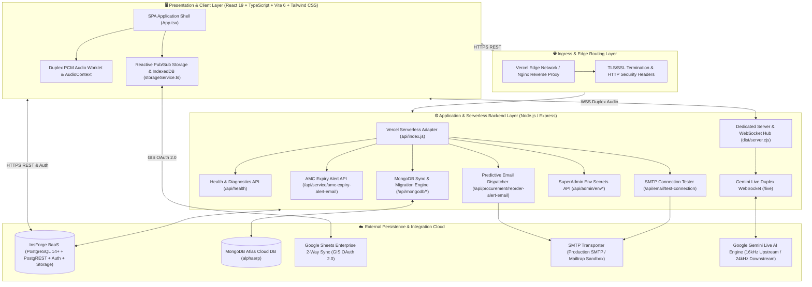
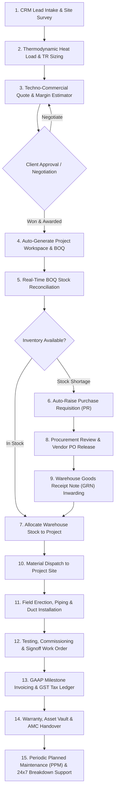
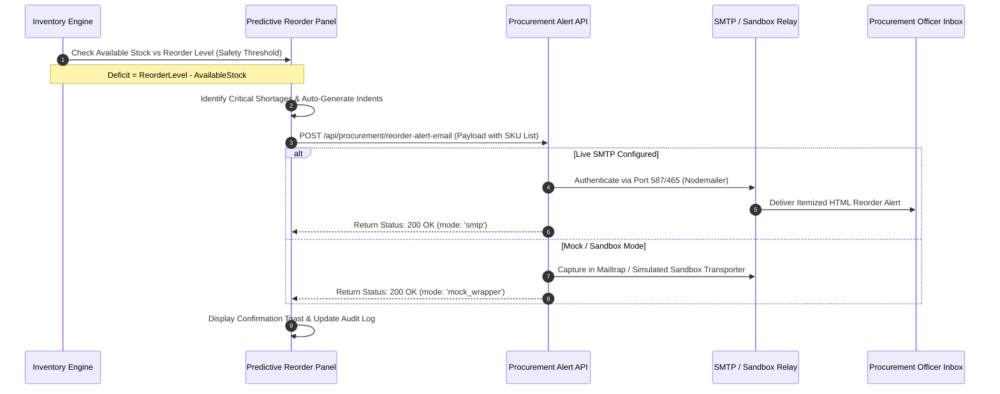

# AlphaERP — Enterprise HVAC Systems, Engineering & Resource Planning Suite

## Full-Lifecycle Techno-Commercial CRM, BOQ Engineering, Multi-Tier Procurement, Automated Email Indents, GAAP Financials & HRMS Platform

[](https://github.com/gautam303in/AlphaERP-HVAC)
[](https://hvacbiz.insforge.site/#dashboard)
[](https://as2hwz72.us-east.insforge.app)
[-10B981?style=for-the-badge)](#11-enterprise-uat-test-verification-suite)
[](https://hvacbiz.insforge.site)
[](https://hvacbiz.insforge.site)
[](https://react.dev/)
[](https://www.typescriptlang.org/)
[](https://tailwindcss.com/)
[](https://www.mongodb.com/atlas)
[](https://ai.google.dev/)

---

## 🌐 Live Production Deployment

- **Custom InsForge Production URL**: [https://hvacbiz.insforge.site/#dashboard](https://hvacbiz.insforge.site/#dashboard) (Primary Custom Domain)
- **Vercel Mirror Production URL**: [https://hvacbiz.vercel.app](https://hvacbiz.vercel.app)
- **GitHub Repository**: [https://github.com/gautam303in/AlphaERP-HVAC](https://github.com/gautam303in/AlphaERP-HVAC)
- **InsForge BaaS API Endpoint**: [https://as2hwz72.us-east.insforge.app](https://as2hwz72.us-east.insforge.app)
- **API Health Diagnostics**: [https://hvacbiz.vercel.app/api/health](https://hvacbiz.vercel.app/api/health)
- **Quality Verification**: [100% Passing Enterprise UAT Suite (24 Use Cases, 92 Verification Steps)](#11-enterprise-uat-test-verification-suite)
- **Primary Runtime**: Vercel Serverless Edge Network & Node.js 20+ Hybrid Container Backend with InsForge BaaS PostgreSQL 14+

---

## 1. Executive Summary & Enterprise Overview

**AlphaERP** is an enterprise-grade ERP, CRM, and Supply Chain automation platform engineered specifically for commercial Heating, Ventilation, and Air Conditioning (**HVAC**) contractors, Mechanical, Electrical & Plumbing (**MEP**) engineering consultancies, and turnkey HVAC system integrators.

Commercial HVAC projects operate under stringent engineering constraints, high-value procurement cycles, multi-tier regulatory compliance, and multi-stage milestone billings:

1. **High-Tonnage Custom Sizing**: Thermodynamic equipment selection (Tonnage of Refrigeration - TR, CFM air flow, Static Pressure ESP, Chilled Water flow rates, ambient temperature derating).
2. **Multi-Category Bill of Quantities (BOQ)**: Complex quotations spanning heavy machinery (VRV/VRF outdoor units, modular chillers, precision AHUs), sheet metal ductwork (GI 24/22/20G), thermal/acoustic insulation (Nitrile/Glasswool), hard-drawn copper piping, motorized butterfly/modulating valves, refrigerants (R-410A/R-32), and certified field labor.
3. **Real-Time Inventory Allocation & Predictive Procurement**: Equipment must be reserved or procured just-in-time from specialized OEMs. When stock falls below safety levels, the system automatically dispatches email indents to procurement officers.
4. **Services, AMC Contracts & Telemetry**: Comprehensive & Non-Comprehensive Annual Maintenance Contracts (AMC), automated 30-day renewal alerts, Periodic Planned Maintenance (PPM) scheduling, emergency breakdown dispatch, spare parts inventory van allocation, and 4-point HVAC telemetry logging (Suction PSI, Discharge PSI, Delta T, Motor Amperage).
5. **Phased Milestone Contracting & GAAP Financials**: Commercial contracting requires milestone-based billing (30% Advance, 40% Delivery, 20% Erection, 10% Testing & Commissioning Handover) tied to double-entry accounting ledgers and tax compliance (GST & TDS).
6. **Human Capital & Field Workforce Operations**: Integrated HRMS managing 12 sub-modules (Attendance Regularization, Payroll Payslip Generation, Employee Asset Allocations, Digital Document Vault, KRA Job Requisitions, Candidate Tracking, Grievances, Travel & Per-Diem Claims, and Full & Final Settlements).
7. **Enterprise Governance, DRM Licensing & SoD Matrix**: Strict Segregation of Duties (SoD) conflict detection, 36 granular enterprise functions across 9 domains, dynamic organization logo customizer, time-based enterprise DRM licensing engine (7-day to lifetime/custom with seat caps), and SuperAdmin-exclusive Investor Pitch Deck.
8. **Live Multi-Cloud Persistence & AI Voice Interaction**: Native bidirectional sync with MongoDB Atlas, Google Sheets enterprise export, and real-time duplex voice assistance via Gemini Live API.

---

## 2. System Architecture & Topology

AlphaERP operates on a multi-tiered architecture designed for zero-latency user interaction, resilient offline-first state, cloud synchronization, and serverless compute scale.



---

## 3. End-to-End Business Process Flows

### 3.1 Complete HVAC Techno-Commercial Lifecycle Flow



### 3.2 Predictive Inventory Safety-Stock & Automated Email Flow



---

## 4. Key Operational Modules

| # | Module Name | Key Functional Capabilities | Primary File Location |
| :---: | :--- | :--- | :--- |
| **1** | **Executive Dashboard** | Real-time P&L, contract burn rate, gross margin analysis, project progress radar, live company activity feed. | `src/components/DashboardView.tsx` |
| **2** | **CRM & Lead Pipeline** | HVAC lead qualification, cooling tonnage (TR) sizing, client metadata, site survey scheduling, pipeline stage kanban. | `src/components/CRMLeadsView.tsx` |
| **3** | **Techno-Commercial Quotes** | Multi-category BOQ pricing engine, margin percentage calculators, statutory 18% GST computations, PDF generation. | `src/components/QuotesView.tsx` |
| **4** | **Projects & BOQ Reconciliation** | Gantt milestones, active site tracking, live stock cross-check, auto-shortage calculation, single-click PR trigger. | `src/components/ProjectsBOQView.tsx` |
| **5** | **Procurement PR & PO Hub** | Purchase requisition approvals, vendor PO dispatch via WhatsApp/Email, multi-stage financial signoff workflow. | `src/components/ProcurementPRPOView.tsx` |
| **6** | **Warehouse Inventory & GRN** | Bin locations, stock allocation, Goods Receipt Note (GRN) inwarding, unit cost averaging, stock valuation. | `src/components/InventoryWarehouseView.tsx` |
| **7** | **Predictive Reorder Indents** | Safety stock monitoring, deficit analysis, automated itemized procurement email dispatch with SMTP admin panel. | `src/components/PredictiveInventoryReorderPanel.tsx` |
| **8** | **Services & AMC Management** | Comprehensive & Non-Comprehensive AMC contracts, 30-day renewal alerts, breakdown tickets, equipment registry & 4-point telemetry. | `src/components/ServicesAMCView.tsx` |
| **9** | **PPM Dispatch & Field Schedule** | Planned Preventive Maintenance calendar, fleet routing, technician work queue, truck spare parts allocation. | `src/components/ServiceScheduleView.tsx` |
| **10** | **Field Work Orders & Testing** | Mobile-ready commissioning checklists, digital client signature capture, technician dispatch, site photo vault. | `src/components/WorkOrdersView.tsx` |
| **11** | **Milestone Invoicing & Receipts** | Phased milestone billing (Advance, Delivery, Erection, Handover), GST tax invoices, payment receipt vouchers. | `src/components/FinancePaymentsView.tsx` |
| **12** | **GAAP Double-Entry Ledger** | Journal entries, general ledger, trial balance, automated accounts receivable (AR) and accounts payable (AP). | `src/components/FinanceView.tsx` |
| **13** | **HRMS Suite (12 Modules)** | Attendance, payroll payslips, asset tracking, doc vault, KRA requisitions, applicant tracking, travel claims, F&F settlement. | `src/components/HRView.tsx` |
| **14** | **Sales Quota & Leaderboard** | Target vs achievement tracking, quarterly quota analysis, representative win-rate leaderboards, incentive tiers. | `src/components/SalesPerformanceView.tsx` |
| **15** | **Gemini Live AI Voice Assistant** | Duplex real-time voice streaming (`ws://<host>/live`), HVAC thermodynamics calculations, technical equipment lookup. | `src/components/LiveAudioAssistantModal.tsx` |
| **16** | **MongoDB Atlas Cloud Sync** | Dual-direction cloud database synchronization, backup snapshot exports, connection health ping monitor. | `src/components/MongoSyncModal.tsx` |
| **17** | **Project Cost Variance & Margin Erosion** | BOQ baseline vs committed POs vs actual GRN spend, itemized cost variances, and automated vector PDF reports. | `src/components/ProjectCostAnalysisView.tsx` |
| **18** | **Interactive Pitch Deck Engine** | 18-slide investor pitch deck with live operational metrics, fullscreen presentation mode, speaker notes & PDF export. | `src/components/PitchDeckView.tsx` |
| **19** | **Engineering Thermodynamic UOM Converter** | Conversions across Cooling TR, kW, HP, BTU/hr, Airflow CFM, CMH, L/s, Pressure Bar, PSI, Pa, InWg, and Temperature. | `src/utils/uomConverter.ts` |

---

## 5. Mathematical Formulations & HVAC Calculations

### 5.1 Techno-Commercial Quotation Sizing

$$\text{Taxable Revenue} = \left( \sum_{i=1}^{n} \text{Quantity}_i \times \text{Unit Rate}_i \right) - \text{Commercial Discount}$$
$$\text{Statutory GST (18\%)} = \text{Taxable Revenue} \times 0.18$$
$$\text{Grand Total Quoted} = \text{Taxable Revenue} + \text{Statutory GST}$$
$$\text{Gross Margin (\%)} = \left( \frac{\text{Taxable Revenue} - \text{Total Raw Material Cost}}{\text{Taxable Revenue}} \right) \times 100$$

### 5.2 BOQ Deficit & Safety-Stock Reorder Evaluation

$$\text{Available Stock} = \text{Current Physical Warehouse Stock} - \text{Allocated Stock}$$
$$\text{Shortage Quantity} = \max\Big(0, \, \text{BOQ Quantity Required} - \text{Available Stock}\Big)$$
$$\text{Suggested Reorder Indent} = \max\Big(0, \, \text{Reorder Level Threshold} - \text{Available Stock}\Big)$$

---

## 6. Role-Based Access Control (RBAC) Matrix

| Persona / Role | Leads CRM | Quotes | Projects & BOQ | Procurement | Warehouse | Services & AMC | Field Tickets | Finance & Invoicing | HRMS | Pitch Deck | DRM Licensing | Admin & Settings |
| :--- | :---: | :---: | :---: | :---: | :---: | :---: | :---: | :---: | :---: | :---: | :---: | :---: |
| **Root SuperAdmin** | ✅ Full | ✅ Full | ✅ Full | ✅ Full & Sign | ✅ Full | ✅ Full | ✅ Full | ✅ Full | ✅ Full | 👑 Exclusive | 👑 Exclusive | ✅ Full & License |
| **Enterprise Admin** | ✅ Full | ✅ Full | ✅ Full | ✅ Full & Sign | ✅ Full | ✅ Full | ✅ Full | ✅ Full | ✅ Full | ❌ | ❌ | ✅ Full Admin |
| **Executive / MD** | ✅ Full | ✅ Full | ✅ Full | ✅ Full & Sign | ✅ Full | ✅ Full | ✅ Full | ✅ Full | ✅ Full | ❌ | ❌ | ✅ Full & Users |
| **Sales Manager** | ✅ Full | ✅ Full | 👁️ View | 👁️ View | 👁️ Stock | 👁️ Contracts | 👁️ View | 👁️ Receivables | 👁️ Team | ❌ | ❌ | ❌ |
| **HVAC Estimator** | 👁️ Leads | ✅ Full | 👁️ BOQ | ✍️ Raise PR | 👁️ Stock | 👁️ View | 👁️ View | 👁️ Margins | 👤 Self | ❌ | ❌ | ❌ |
| **Procurement Head** | 👁️ View | 👁️ Costs | 👁️ BOQ | ✅ Full & PO | ✅ Manage | 👁️ Spares | 👁️ View | 👁️ Payables | 👤 Self | ❌ | ❌ | ❌ |
| **Warehouse Keeper** | ❌ | ❌ | 👁️ BOQ | 📦 GRN Inward | ✅ Full | 📦 Spares Dispatch | ❌ | ❌ | 👤 Self | ❌ | ❌ | ❌ |
| **Finance Controller** | 👁️ Won | 👁️ Approved | 👁️ Value | 👁️ POs | 👁️ Value | 👁️ AMC Billing | 👁️ Work Orders | ✅ Full | ✅ Payroll Admin | ❌ | ❌ | ❌ |
| **Service Operations Manager** | 👁️ Client Info | 👁️ Quotes | 👁️ Sites | ✍️ Request Spares | 👁️ Van Stock | ✅ Full (AMC/PPM/Roster) | ✅ Full & Dispatch | 👁️ Invoices | 👁️ Team | ❌ | ❌ | ❌ |
| **Lead / Service Engineer** | ❌ | ❌ | 👁️ Site | ❌ | 👁️ Allocated Spares | ✍️ Log PPM & Breakdown | ✅ Full & Sign | ❌ | 👤 Self | ❌ | ❌ | ❌ |

> **SuperAdmin Exclusive Access:** The **Investor Pitch Deck (`pitch_deck`)** and **Enterprise DRM Licensing (`license`)** modules are strictly reserved for the `superadmin` role.
> **Admin Module Assignment:** The `superadmin`, `admin`, and `executive` roles can grant or revoke sidebar module access for any role at runtime via **System & Administration → Users & RBAC Roles**. Permissions are persisted to `localStorage` and take effect immediately — no page reload required.
> **Permissions Auto-Reset on Upgrade:** When `PERMISSIONS_SCHEMA_VERSION` is bumped in `src/services/storageService.ts` (current: `'5'`), each user's browser automatically rebuilds its cached role-module permissions from the latest defaults in `src/utils/rbac.ts` on the next page load.

---

## 7. Default System Personas (Instant Login)

The system supports instant authentication via **OTP** with master passcodes `123456` or `999999` with convenient 1-click login quick-switch banners:

- **Root SuperAdmin**: `superadmin@airdynamic.com` (Siddharth Sengupta — Root Corporate Governance, Pitch Deck & DRM Licenses)
- **Enterprise Admin**: `admin@airdynamic.com` (Rohan Deshmukh — System Operations & Enterprise Administration)
- **Executive / MD**: `vikram.m@airdynamic.com` (Vikram Malhotra — Executive Management & Strategy)
- **Sales Manager**: `rajesh.s@airdynamic.com` (Rajesh Sharma — CRM & Quota Leaderboard)
- **HVAC Estimator**: `ananya.d@airdynamic.com` (Ananya Deshmukh — Thermodynamics & BOQ Sizing)
- **Procurement Manager**: `karan.m@airdynamic.com` (Karan Mehta — PR Review & Vendor PO Release)
- **Warehouse Storekeeper**: `suresh.k@airdynamic.com` (Suresh Kumar — Stock Inwarding & GRN)
- **Finance Controller**: `pooja.i@airdynamic.com` (Pooja Iyer — Milestone GST Invoices & Ledger)
- **Service Operations Manager**: `service.manager@company.com` / `rajesh.v@airdynamic.com` (Rajesh Varma — AMC Contracts, PPM Calendar, Fleet Dispatch & Telemetry)
- **Service Engineer / Technician**: `service.engineer@company.com` / `amit.v@airdynamic.com` (Vikram Sundaram / Amit Verma — Field PPM Checklists, Breakdown Tickets & Signoff)

---

## 8. Project Directory Structure

```text
AlphaERP-V1/
├── api/
│   └── index.ts                         # Vercel Serverless Function entry adapter
├── data/
│   └── mongodb_local_vault.json         # Local MongoDB vault with mock project records & offline fallback
├── server/
│   ├── app.ts                           # Express application & REST API routes
│   ├── api-entry.ts                     # Bundling entry for Vercel Serverless Function
│   ├── envManager.ts                    # Dynamic .env secrets manager & validation
│   └── mongodb.ts                       # MongoDB Atlas connection manager & sync engine
├── server.ts                            # Standalone Node.js server with WebSockets & dynamic port allocation
├── vercel.json                          # Vercel routing, rewrite rules, security headers
├── database/
│   ├── schema.sql                       # PostgreSQL 14+ DDL relational schema
│   ├── insforge_schema.sql              # InsForge BaaS PostgreSQL schema
│   ├── seed_data.sql                    # Production-grade HVAC master demo seed data
│   └── AlphaERP_Full_Backup_*.json      # Full JSON database backup snapshot
├── package.json                         # Dependencies, scripts, and build pipeline
├── vite.config.ts                       # Vite bundler configuration with React & Tailwind
├── src/
│   ├── App.tsx                          # Root application shell, navigation & auth state
│   ├── main.tsx                         # React 19 mounting entry point
│   ├── index.css                        # Tailwind CSS global styling tokens & themes
│   ├── types/
│   │   └── index.ts                     # Global TypeScript interfaces, models & DRM license contracts
│   ├── services/
│   │   ├── storageService.ts            # Reactive Pub/Sub state, local storage, DRM licensing & audit log
│   │   ├── amcRenewalNotificationService.ts # 30-Day AMC contract renewal email notifications
│   │   ├── unifiedProjectSyncService.ts # Multi-cloud database synchronizer (InsForge, Mongo, IndexedDB)
│   │   ├── googleSheets.ts              # Google Identity Services (GIS) 9-tab sync
│   │   ├── whatsappEmailService.ts      # Automated SMTP alerts & WhatsApp generator
│   │   └── exportService.ts             # CSV & PDF generation engines
│   └── components/
│       ├── Header.tsx                   # Top bar, role selector, persona quick-switch & license status
│       ├── Sidebar.tsx                  # Collapsible multi-module navigation sidebar
│       ├── DashboardView.tsx            # Executive KPI summary & revenue charts
│       ├── CRMLeadsView.tsx             # Lead management, sizing & survey tracker
│       ├── QuotesView.tsx               # HVAC quotation builder & pricing engine
│       ├── ProjectsBOQView.tsx          # Project execution & BOQ shortage cross-check
│       ├── ProcurementPRPOView.tsx      # PR approval workflow & PO vendor dispatch
│       ├── InventoryWarehouseView.tsx   # Warehouse inventory & stock tracker
│       ├── PredictiveInventoryReorderPanel.tsx # Predictive stock alerts & email dispatch
│       ├── ServicesAMCView.tsx          # Comprehensive AMC contracts, breakdown tickets & equipment registry
│       ├── ServiceScheduleView.tsx      # PPM calendar, technician routing & truck inventory
│       ├── WorkOrdersView.tsx           # Field engineering tickets & commissioning
│       ├── FinancePaymentsView.tsx      # Milestone billing & GST invoice ledger
│       ├── FinanceView.tsx              # GAAP double-entry ledger & vouchers
│       ├── HRView.tsx                   # 12-Module HRMS & Payroll Suite
│       ├── SalesPerformanceView.tsx     # Quota tracking & performance charts
│       ├── LicenseManagementView.tsx    # Enterprise DRM license generator & seat control (SuperAdmin only)
│       ├── PitchDeckView.tsx            # Stakeholder & Investor Pitch Deck presentation (SuperAdmin only)
│       ├── OrganizationLogoCustomizer.tsx # Enterprise branding logo customizer & dual-theme previews
│       ├── SodMatrixManager.tsx         # Segregation of Duties (SoD) governance matrix
│       ├── EnterpriseFunctionsRolesManager.tsx # Granular 36 enterprise functions catalog & custom roles
│       ├── EnvironmentVariablesAdminSection.tsx # SuperAdmin secrets & .env management panel
│       ├── EmailSettingsAdminSection.tsx# SMTP credentials & Dummy Sandbox settings
│       ├── LiveAudioAssistantModal.tsx  # Gemini Live real-time voice assistant
│       ├── MongoSyncModal.tsx           # MongoDB Atlas bidirectional cloud sync
│       ├── UserManagementView.tsx       # RBAC user administration & account activation/deactivation
│       └── AuditLogView.tsx             # Immutable event ledger & compliance logs
```

---

## 9. Build, Deployment & Local Setup

### 9.1 Local Development Setup

```bash
# 1. Install dependencies
npm install

# 2. Start full-stack development server (Express API + Vite Dev Server + WebSockets)
npm run dev

# 3. Access locally in browser
# http://localhost:3001 (auto-allocates next free port if 3001 is occupied)
```

### 9.2 Production Build

```bash
# Single command builds frontend SPA, serverless adapter, and standalone server bundle
npm run build
```

The build command produces:

- `dist/`: Client-side optimized React 19 SPA assets.
- `dist/server.cjs`: Standalone Node.js server bundle for Docker/Cloud Run/Ubuntu.
- `api/index.js`: Serverless bundle for Vercel Serverless Functions.

### 9.3 Deploy to Vercel (Production)

```bash
npx vercel deploy --prod --yes
```

### 9.4 Deploy to InsForge Edge & Custom Domain

Deploy the built production bundle directly to InsForge BaaS hosting:

```bash
# 1. Build application bundles
npm run build

# 2. Deploy to InsForge edge hosting
npx @insforge/cli deployments deploy .
```

- **Live Production URL**: [https://hvacbiz.insforge.site/#dashboard](https://hvacbiz.insforge.site/#dashboard)
- **InsForge Backend Project**: `hvac-biz` (`https://as2hwz72.us-east.insforge.app`)
- **SSL / TLS**: Automatic HTTPS certificate issued for `hvacbiz.insforge.site`

---

## 10. Industry Compliance & Standards

- **ASHRAE 90.1 / 62.1**: Energy efficiency standards and indoor ventilation air quality guidelines.
- **ISHRAE**: Indian Society of Heating, Refrigerating and Air Conditioning Engineers standards.
- **GAAP / Ind AS 115**: Revenue recognition from contracts with customers and double-entry accounting.
- **GST / TDS**: Indian statutory tax calculation for goods (18%) and services with HSN/SAC codes.

---

## 11. Enterprise UAT Test Verification Suite

AlphaERP includes a comprehensive end-to-end automated business UAT suite validating all 24 core enterprise workflows with 92 distinct verification assertions:

```bash
# Run the automated Enterprise UAT Test Suite
npm run test:uat
```

### Verified Test Matrix (100% Passing • 24 Cases / 92 Verification Steps)

| Case ID | Module & Business Use Case | Key Assertions Verified | Status |
| :---: | :--- | :--- | :---: |
| **UAT-01** | **CRM Lead Intake & Heat-Load Tonnage** | 500 CFM/TR thermodynamic derating, TR calculation, Lead qualification | ✅ PASS |
| **UAT-02** | **Quotation BOQ Pricing & 18% GST** | Multi-item summation, commercial discount, exact ₹4,71,600 GST computation | ✅ PASS |
| **UAT-03** | **Awarded Quote to Project BOQ Sync** | State transitions, BOQ reconciliation, automatic material deficit identification | ✅ PASS |
| **UAT-04** | **Field Work Order & Client Signoff** | Checklist validation, field photo attachment, technician signature seal | ✅ PASS |
| **UAT-05** | **Procurement PR to Vendor PO Lifecycle** | PR validation, multi-tier approvals, vendor PO generation, delivery terms | ✅ PASS |
| **UAT-06** | **Warehouse GRN & Inventory Valuation** | Goods Receipt Note, bin location inwarding, weighted average unit cost adjustment | ✅ PASS |
| **UAT-07** | **Milestone Invoicing & GAAP Journal AR** | Milestone billing (Advance, Erection, Handover), GAAP ledger entry, AR debit | ✅ PASS |
| **UAT-08** | **HRMS Payroll & Statutory Payslip** | CTC structure, PF (12%), ESIC (0.75%), Professional Tax, Net Salary calculation | ✅ PASS |
| **UAT-09** | **Role-Based Access Control (RBAC)** | Role permissions enforcement across 10 enterprise personas including SuperAdmin & Admin | ✅ PASS |
| **UAT-10** | **MongoDB Atlas Dual-Direction Sync** | Export payload compilation, Atlas schema validation, immutable audit log verification | ✅ PASS |
| **UAT-11** | **Project Cost Variance & Margin Erosion** | Baseline BOQ cost vs committed POs vs actuals, variance computation, alert thresholds | ✅ PASS |
| **UAT-12** | **Thermodynamic UOM Conversions** | Precise physical conversions: TR to kW/BTU/hr, CFM to CMH, Bar to PSI/Pa | ✅ PASS |
| **UAT-13** | **HVAC Services & AMC Lifecycle & PPM** | Comprehensive/Non-comprehensive AMCs, quarterly PPM schedule, technician allocation | ✅ PASS |
| **UAT-14** | **Emergency Breakdown Tickets & Spares** | 24x7 priority dispatch, SLA escalation, truck spare parts consumption, on-site billing | ✅ PASS |
| **UAT-15** | **Application-Wide Data Sanity & Validation** | Indian 10-digit mobile, RFC 5322 email, PAN, GSTIN, Aadhaar, past DOB constraints | ✅ PASS |
| **UAT-16** | **AMC Contracts, Google Sheets & 30-Day Email** | 9-Tab Google Sheets sync, automated 30-day renewal notice dispatch via SMTP relay | ✅ PASS |
| **UAT-17** | **Service Manager & Engineer Dual Personas** | Dual-persona workflow, 4-point telemetry logs (PSI/Delta T/Amps), audit trail verification | ✅ PASS |
| **UAT-18** | **Advanced HRMS Sub-Modules** | IT/safety asset allocation, per-diem travel claims, grievance escalation, recruitment & F&F | ✅ PASS |
| **UAT-19** | **Sales Quotas & Tiered Commissions** | Sales quota attainment, gross-margin weighted ranking, tiered incentive payouts | ✅ PASS |
| **UAT-20** | **GAAP Double-Entry Ledger & JV** | Multi-line balanced journal vouchers (Debit === Credit), 5% DLP retention money release | ✅ PASS |
| **UAT-21** | **Multi-Tab Google Sheets Sync Engine** | 40+ Enterprise collections marshalling, schema label mapping, normalization & row sanitization | ✅ PASS |
| **UAT-22** | **System Security & Anti-Tamper Audit** | Prototype pollution protection, sandbox diagnostics verification, immutable audit log trail | ✅ PASS |
| **UAT-23** | **Enterprise Branding, SoD & Roles** | Dynamic branding logo customizer, 36 enterprise functions, SoD conflict detection & overrides | ✅ PASS |
| **UAT-24** | **SuperAdmin, User Activation & DRM Licensing** | Root SuperAdmin governance, user activation toggles, timeframe-based DRM licenses & verification | ✅ PASS |

---

## 12. InsForge BaaS Architecture & PostgreSQL Schemas

AlphaERP is configured with [InsForge](https://insforge.dev) for relational PostgreSQL storage, JWT authentication, file storage buckets, and serverless edge delivery.

- **Project Base URL**: `https://as2hwz72.us-east.insforge.app`
- **Custom Site Domain**: `https://hvacbiz.insforge.site`
- **Relational Schema Files**: `database/schema.sql` and `database/insforge_schema.sql`

### SDK Client Initialization Pattern

```typescript
import { createClient } from '@insforge/sdk';

export const insforge = createClient({
  baseUrl: process.env.VITE_INSFORGE_URL || 'https://as2hwz72.us-east.insforge.app',
  anonKey: process.env.VITE_INSFORGE_ANON_KEY || 'your-anon-key-here'
});
```

### Critical InsForge Engineering Standards

1. **Array Format Inserts (Mandatory)**:
   All database inserts must supply an array of objects:

   ```typescript
   // CORRECT
   await insforge.database.from('projects').insert([{ project_code: 'PRJ-2026-001', name: 'One BKC Tower' }]);
   ```

2. **Tuple Response Handling**:
   All operations return `{ data, error }`. Always guard against `error` before consuming `data`.
3. **Row Level Security (RLS)**:
   Tables enforce tenant and user isolation referencing `auth.users(id)` and `auth.uid()`.
4. **Storage Uploads**:
   Always persist both the returned `url` and `key` for cloud assets (equipment specs, work order signatures, and site photos).
